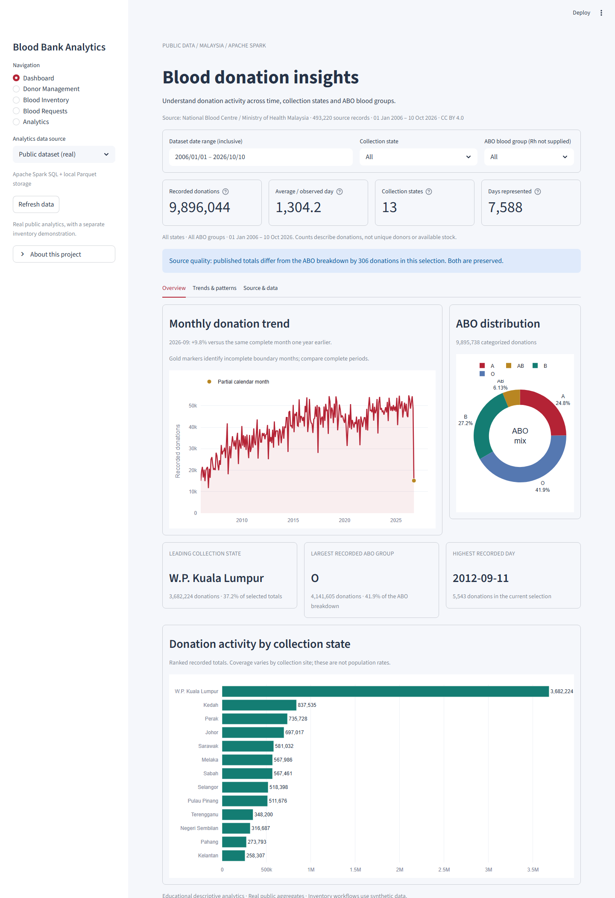
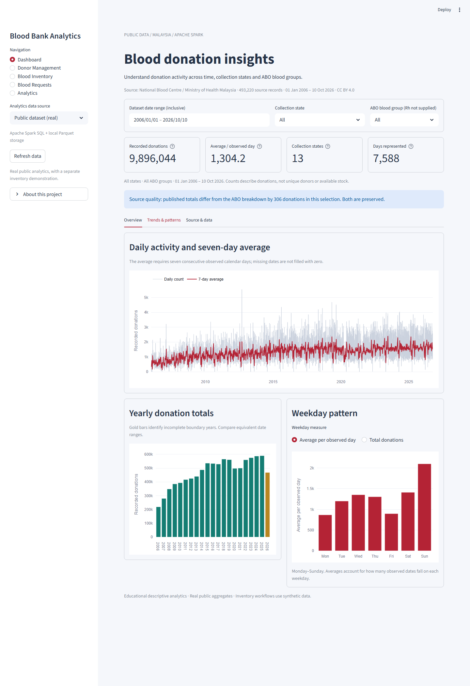

# Blood Bank Management and Inventory Analytics Using Apache Spark

This is now a **Spark SQL + local Parquet** project. MongoDB is NOT required to run the application. The five Streamlit pages, public dataset, chart types, filters, synthetic management workflow, FEFO and alerts remain.

Spark is a processing engine, not a transactional database. Parquet stores the data; Spark executes the analytical SQL. Python and PyArrow manage validated local snapshot writes. No Hadoop cluster, HDFS service, Kafka, Docker or machine learning is required.

## Real-data dashboard

The public dashboard presents the official dataset through three simple tabs: **Overview**, **Trends & patterns**, and **Source & data**. It includes a monthly trend, ABO mix, ranked collection states, selection-based findings, daily counts with a seven-day average, yearly totals, and weekday comparisons. Gold markers/bars identify incomplete calendar periods. Downloads contain the selected summary with its filter context.

The snapshot has **493,220 source records** from **2006-01-01 to 2026-10-10**. It represents **9,896,044 published recorded donations**, not that many individual database rows. Source totals and the ABO breakdown differ by 306; that difference is disclosed. All source records were verified against Parquet.

## Run now on this computer

The dependencies, project-local Java 21 and migrated Parquet data are already installed here.

~~~powershell
cd C:\Users\avira\Desktop\bda
.\.venv\Scripts\python.exe -m streamlit run app.py
~~~

Open **http://localhost:8501**. Keep the terminal open. First Spark startup takes longer than subsequent interactions. Stop an older Streamlit instance with Ctrl+C before restarting; do not leave the old MongoDB application running.

- **Public dataset (real)**: donation trends, ABO distribution and collection-state activity.
- **Inventory demo (simulated)**: inventory dashboard and alerts.
- Donor Management, Blood Inventory and Blood Requests always operate on synthetic records.

The official dataset lacks individual units, Rh, requests and expiry dates. Those fields are not invented as real observations.

## Architecture

~~~text
Official CSV -> validate / type with Pandas -> Parquet public snapshot
                                                   |
Browser -> Streamlit -> Spark SQL -> Parquet FileScan / filters / aggregations
                |
                +-> Python validated management operation
                    -> local writer lock -> new Parquet snapshots
                    -> atomic current.json pointer replacement
~~~

Two namespaces under data/spark:
- public/daily_donations: 493,220 real date/state/ABO observations.
- management: donors, donations, blood_requests (the original synthetic workflow).

Spark runs in local[2] mode: two worker threads in a local process, NOT two cluster machines. It uses Catalyst planning, grouping, shuffle exchanges and Parquet scans. Main chart aggregations execute in Spark, not Pandas. PyArrow writes interoperable Parquet to avoid relying on unofficial Hadoop Windows helper binaries.

## Technology stack

Python, PySpark 4.0.1, Java 21, Parquet/PyArrow, Streamlit, Pandas, Plotly, Faker and python-dotenv. Python's standard library provides locks, UUIDs, hashing and unittest. PyMongo is optional ONLY for one-time import from the old database.

## Files

| File | Responsibility |
|---|---|
| app.py | Same five pages and forms, using Spark-backed reports |
| presentation.py | Consistent charts, complete-period comparisons and descriptive findings |
| database.py | Spark session, schemas, Parquet storage, locking and snapshot publication |
| operations.py | Validation, donor/unit/request operations and FEFO |
| analytics.py | Operational Spark SQL queries and execution-plan inspection |
| public_data.py | Official CSV validation, import, full comparison and six Spark SQL queries |
| seed_data.py | Optional synthetic operational dataset |
| migrate_mongodb.py | Optional read-only old-data migration; never deletes MongoDB |
| verify_project.py | Read-only integrity audit and isolated scale checks |
| test_project.py / test_public_data.py / test_robustness.py | Unit, failure, Spark and UI tests |
| test_presentation.py | Period completeness, denominator accuracy and missing-day handling |
| qa_full_dataset.py / qa_visual.py | Full-data AppTest and optional headless-browser evidence |
| config.py / .env.example | Settings and safe defaults |
| data/raw/blood_donations_state.csv | Unchanged official source |
| data/dataset_manifest.json | Source provenance |
| backups/mongodb-version-2026-10-29/ | Preserved pre-migration source/docs |

## Setup on another Windows computer

1. Install 64-bit Python 3.12+ and VS Code. The local verification environment uses Python 3.14.
2. Install Java 21 from [Eclipse Temurin](https://adoptium.net/temurin/releases/?version=21). Spark 4.0.1 supports Java 17/21; Java 8 is insufficient.
3. Open the copied project folder and create a virtual environment:

~~~powershell
python -m venv .venv
.\.venv\Scripts\python.exe -m pip install -r requirements.txt
if (-not (Test-Path .env)) { Copy-Item .env.example .env }
~~~

4. If Java 21 is not already JAVA_HOME, set its actual installation directory in .env:

~~~dotenv
SPARK_JAVA_HOME=C:/Program Files/Eclipse Adoptium/your-actual-jdk-21-directory
SPARK_MASTER=local[2]
SHELF_LIFE_DAYS=42
LOW_STOCK_THRESHOLD=5
NEAR_EXPIRY_DAYS=7
~~~

The supplied computer instead auto-detects the JDK in .runtime/java21. That large runtime is intentionally ignored by Git. SPARK_DATA_DIR can override the default project/data/spark directory. Legacy MONGODB settings are ignored by the active app.

5. Import the included official CSV and optionally create synthetic management data:

~~~powershell
.\.venv\Scripts\python.exe public_data.py
.\.venv\Scripts\python.exe public_data.py --verify-only
# Only for an empty management namespace:
.\.venv\Scripts\python.exe seed_data.py --records 5000
.\.venv\Scripts\python.exe database.py
.\.venv\Scripts\python.exe -m streamlit run app.py
~~~

No MongoDB service is needed. Importing the same CSV verifies its contents and does not duplicate rows. The default CSV is downloaded only when missing.

The source CSV is included in this repository so the presentation does not depend on a new download. On a fresh setup, run public_data.py once to build Parquet; seed_data.py is only needed if you want synthetic management records. The large Java runtime and local Parquet version history are intentionally excluded from Git.

## Preserve or migrate existing data

The original source was copied to backups/mongodb-version-2026-10-29. Existing MongoDB data was read, not deleted. On this computer, 2,500 donors, 5,000 donations and 1,000 requests were migrated and compared record-by-record.

On another installation, optionally stop the old app and run:

~~~powershell
# Optional migration dependency only:
.\.venv\Scripts\python.exe -m pip install pymongo
.\.venv\Scripts\python.exe migrate_mongodb.py
~~~

Migration refuses to overwrite nonempty management Parquet. It reads the old three collections twice to detect changes, validates relationships, converts ObjectIds to strings, publishes one snapshot and verifies the result. Keep the source idle during migration.

## Storage correctness and limitations

A mutation acquires an in-process lock AND a local OS file lock, reads the committed tables, validates the new state, writes new immutable Parquet files, then replaces one current.json pointer. Inventory and request summaries become visible together. Readers pin a manifest; old files remain usable while newer versions are written. Failures before publication leave the previous snapshot active; after an uncertain acknowledgement, refresh/verify before retrying.

Uniqueness and relationships are enforced in Python while holding the lock, NOT by database indexes. FEFO uses exact group, unissued status and unexpired units; request quantities are capped by demand and stock. Current stock is derived from unit records. The 42-day shelf life and age range are educational assumptions.

This is a local-disk protocol, not Delta Lake, a distributed lock, an ACID database, or a medical system. Keep one normal app process and one importer. Cross-process lock regressions are defensive tests, not a distributed deployment claim. Do not put active storage on a network/synchronized drive or edit current.json manually. The host clock must be correct. Each management mutation rewrites the small operational tables; this is not high-throughput OLTP.

Old and failed unpublished versions are retained rather than auto-deleted. Disk usage grows with edits; no automatic garbage collection or recovery UI is implemented. Back up the entire namespace. Recovery needs a known-good version manifest AND every referenced Parquet file, with all readers/writers stopped. Filesystem atomic replacement is not a guarantee against every hardware/power failure.

## Dataset and analytics

[DATASET.md](DATASET.md) documents attribution, coverage and the published-total discrepancy. The snapshot contains 493,220 observations covering 2006-01-01 to 2026-10-10. Published totals sum to 9,896,044; ABO categories sum to 9,895,738. The 306 discrepancy is disclosed, not corrected. Never add all subtotal rows to the four ABO category rows.

[AGGREGATIONS.md](AGGREGATIONS.md) explains all SQL queries. The Analytics page displays executable SQL and EXPLAIN FORMATTED. MongoDB index comparisons have been replaced by actual Spark plans, pushed-filter/scan inspection and observed elapsed time. There is no fabricated Spark-versus-MongoDB benchmark.

## Testing

~~~powershell
# Storage and pure tests; Spark integration tests are explicitly skipped:
.\.venv\Scripts\python.exe -m unittest discover -v

# Complete suite with actual Spark and Streamlit:
$env:RUN_SPARK_TESTS='1'
.\.venv\Scripts\python.exe -m unittest discover -v
Remove-Item Env:RUN_SPARK_TESTS

.\.venv\Scripts\python.exe public_data.py --verify-only
.\.venv\Scripts\python.exe verify_project.py
# Optional: writes/removes only its temporary test directory:
.\.venv\Scripts\python.exe verify_project.py --scale
~~~

See [VERIFICATION.md](VERIFICATION.md) for measured results, [TESTING.md](TESTING.md) for manual checks and [ROBUSTNESS_REVIEW.md](ROBUSTNESS_REVIEW.md) for fixes and remaining risks. Tests remove only their disposable temporary fixtures, never the live data.

Optional visual review (development tools only): with the app running, install Playwright and its Chromium browser, then run qa_visual.py. This captures the actual public dashboard and tests tabs, filtered totals, download controls and a narrow viewport. Playwright is not an application dependency.

## Troubleshooting

| Symptom | Action |
|---|---|
| Java gateway fails | Use Java 21, verify SPARK_JAVA_HOME, restart the app |
| First chart loads slowly | JVM startup and first Spark jobs take time; allow the operation to complete |
| winutils/native-Hadoop warning | This local setup reads Parquet with Spark and writes via PyArrow; no unofficial binaries are needed for the verified workflow |
| ResourceWarning during tests | PySpark 4.0.1's collection socket cleanup can emit warnings on Python 3.14; inspect actual test outcomes separately |
| Missing module | Install requirements using the same .venv interpreter |
| Snapshot corrupt/missing | Stop writes and restore a known-good complete snapshot; do not silently reseed |
| Writer busy | Wait for the other operation; do not delete the lock file to bypass it |
| Public dashboard empty | Run public_data.py and check SPARK_DATA_DIR |
| Existing demo refuses seed | Keep it, or explicitly confirm seed_data.py --reset after backup |
| Port 8501 occupied | Stop the previous app with Ctrl+C; start only one normal app process |

## College materials

- [REPORT.md](REPORT.md): updated Spark report.
- [PRESENTATION_AND_VIVA.md](PRESENTATION_AND_VIVA.md): Spark presentation and viva answers.
- [DATABASE_DESIGN.md](DATABASE_DESIGN.md): Parquet schemas and snapshot layout.
- [SOURCE_CODE.md](SOURCE_CODE.md): labeled source-code appendix.

Official references: [Spark 4.0.1 overview](https://spark.apache.org/docs/4.0.1/), [Spark SQL Parquet](https://spark.apache.org/docs/4.0.1/sql-data-sources-parquet.html), [Spark SQL EXPLAIN](https://spark.apache.org/docs/4.0.1/sql-ref-syntax-qry-explain.html). This mini project demonstrates local analytics techniques, not a tested distributed installation.
